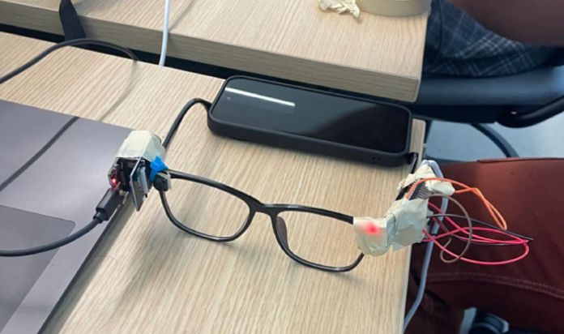

# Verity

**A hands-free AI debugger for hardware.**

Software has debuggers. Your workbench should too.

When software breaks, you get error messages and stack traces. When a circuit
doesn't work, you have to trace physical connections, compare diagrams, and
figure out what went wrong while both hands are busy.

Verity brings debugging into your field of view. Its wearable camera gives an AI
assistant a fresh view of your build, so you can ask questions, check visible
connections against the current instructions, and hear what to inspect or fix.

Double nod, ask “what's wrong here?”, and get spoken guidance without putting
down your tools or opening an app.



*Verity hardware prototype assembled during the hackathon.*

All four software components are implemented and integrated on **`main`**: device/IMU, voice, build agents and controller.
The software scenario and hosted speech/vision path have been tested. Firmware
builds successfully for AI Thinker ESP32-CAM using Arduino-ESP32 3.3.3 and
NimBLE-Arduino 2.3.6. Real glasses,
MPU-6050 calibration, BLE performance and a Windows headset still need bench testing.

The firmware supports a separate ESP32-WROOM MPU sender over ESP-NOW.
Start with [two-board setup](docs/ESP_NOW_SETUP.md); the hardware path
requires bench validation before the demo.

## Architecture

```text
MPU-6050 → ESP32-WROOM ── ESP-NOW ──► ESP32-CAM ── BLE ──► Windows session controller
Headset microphone ── Gemini transcription ──► inspection / debug coach / docs
                                                     │
Headset ◄── local system TTS + cancellable playback ◄──┘
```

The laptop owns Bluetooth, audio, state and API keys. Hosted Gemini handles
transcription and model inference. No cloud server or rented GPU is required.
The tested model is `gemini-3.5-flash-lite`. Live inspection requests one fresh
photo rather than continuously streaming video. BLE still shares the 2.4GHz band;
laptop internet is required for hosted calls.

## Windows quick start

Use your own clone and the main branch:

```powershell
git clone https://github.com/Da0t/Verity.git
cd Verity
git switch main
py -3 -m venv .venv
.\.venv\Scripts\python.exe -m pip install -r requirements.txt
.\.venv\Scripts\python.exe -m verity.agents.setup --model gemini-3.5-flash-lite --save
.\.venv\Scripts\python.exe -m unittest discover -s tests -v
.\.venv\Scripts\python.exe -m verity.app --mock
```

Enter the Gemini key at the hidden terminal prompt. Successful setup writes local
`.env.agents`, ignored by Git. Each machine needs its own configuration; credentials
are not included in the repository. This is a private repository requiring access.

Mock mode runs a scripted six-turn scenario and exits. It uses simulated gesture,
audio, camera and model behavior, and labels all outputs as simulated. It requires
no BLE hardware, microphone or API key after dependencies are installed.

## Configure the hardware and audio

1. Confirm the **AI Thinker-compatible original ESP32-CAM** pinout. The MB USB
   baseboard alone does not identify the camera board. Follow
   [device setup](docs/DEVICE_SETUP.md) and open
   `firmware/CircuitGlasses/CircuitGlasses.ino` in Arduino IDE.
2. Install Arduino-ESP32 **3.3.3**, NimBLE-Arduino **2.3.6**, and the repo's
   shared `VerityLink` library. Follow [two-board setup](docs/ESP_NOW_SETUP.md) for
   the sensor sketch, verified I2C wiring, mutual STA MACs and fixed channel.
3. Power both boards and hold the sensor still for about two seconds to calibrate.
   Check fresh motion status before proceeding. The BLE device still advertises
   as `CircuitGlasses`.
4. Enable laptop Bluetooth and connect a USB/wired headset with microphone.
   Windows must allow microphone access for desktop apps. List audio devices:

   ```powershell
   .\.venv\Scripts\python.exe -m verity.app --list-audio-devices
   .\.venv\Scripts\python.exe -m verity.app --audio-check
   ```

   Use `--input-device ID --output-device ID` to select the headset.
   The recording threshold auto-calibrates from one second of room noise at startup
   (stay quiet); `--vad-threshold 0.015` fixes it instead.
   Each session logs turns and photos to `runs/<timestamp>/` and prints Q/A to the
   console for onlookers; `--log-dir ""` disables the log.

To test microphone → AI → spoken reply without either ESP32, run:

```powershell
$env:VERITY_STT_MODEL = 'gemini-3.5-flash-lite'
.\.venv\Scripts\python.exe -m verity.app --voice-only --input-device INPUT_ID --output-device OUTPUT_ID
```

Choose current IDs from `--list-audio-devices`; they can change when Bluetooth
devices connect. Press Enter to speak and `q` to quit. This mode sends
`assets/voice-reference.jpg` with every question as a **fixed reference photo**.
It does not observe the live assembly. Pass `--reference-image path/to/photo.jpg`
to use another JPEG.

For a camera-only diagnostic, `python receiver.py --interactive` saves verified
JPEGs and prints transfer latency. This keyboard diagnostic is separate from the
hands-free app. Failed captures do not overwrite an older image.

## Supply the actual circuit and run

The recipe is what Verity debugs against: each step's expected connections are
the ground truth for “check this”. For pure debugging, a single step describing
the finished circuit is enough; for guided builds, list every step.

`recipes/demo.json` is a **generic template**, not an approved circuit. Copy it,
replace all steps/expected connections with your verified build, and set
`template` to false. Add optional `reference_image` paths to steps, relative to
the recipe JSON. Use real JPEG references and approved documentation records as
explained in [knowledge/README.md](knowledge/README.md).

```powershell
.\.venv\Scripts\python.exe -m verity.app --recipe recipes/your-circuit.json
```

`--allow-template` permits generic diagnostics without pretending the template is
an electrically verified circuit. `--address` selects a particular BLE device.
Use a fresh session JSON and actual photo for the agent-only diagnostic described
in [AGENTS_SETUP.md](docs/AGENTS_SETUP.md).

## Hands-free behavior

* Double nod (down and back, twice) → listening tone → ask one question.
* **Debug:** “Check this” takes a fresh photo and returns pass / issue / unclear
  with the visible evidence. Follow up with questions like “why isn't the LED on?”
  or “what's wrong with this wiring?”.
* **Guide:** double right head turn → next step; double left → previous step. Both
  read the step aloud without listening. A single nod or turn does nothing.
* “What is the next step?” reads the current instruction. “Next” / “back” manually
  move steps; they do not claim the prior step was verified.
* “Repeat” replays the previous answer without a model request.
* Double nod during speech or processing to interrupt and reopen listening. Double
  nods while recording are ignored. Say “stop” after activation to cancel that request.
* “End session” exits. Ctrl+C is available to the demo operator.

The controller serializes turns and drops cancelled results. Calls have deadlines;
there are no unlimited retries or model loops. The coach uses at most one capture,
two scoped document lookups and two model calls per turn. Documentation research
uses curated local records; broad live-web search is not implemented.

## Validation

Automated tests cover BLE protocol/adapter behavior, pure C++ nod detection,
recording endpoint logic, voice cancellation, agent schemas/tool limits, HTTP
failures and controller interruption/recovery. `python -m verity.diagnostics`
performs an explicit live hosted test with synthesized speech and a blank image,
without accessing microphone/BLE hardware or playing through a speaker. Hosted
API usage applies. That diagnostic needs local system TTS (Windows or macOS).

A real wearer must still validate ten photo transfers, gesture false positives,
Windows headset recording/playback and the chosen wiring-error demo. A photo does
not establish continuity or electrical safety. No circuit-specific accuracy is
claimed from the synthetic tests.

Further guides: [team ownership](docs/TEAM_PLAN.md), [interfaces](docs/CONTRACTS.md),
[device](docs/DEVICE_SETUP.md), [voice](docs/VOICE_SETUP.md),
[agents](docs/AGENTS_SETUP.md), [demo/integration](docs/DEMO.md).
