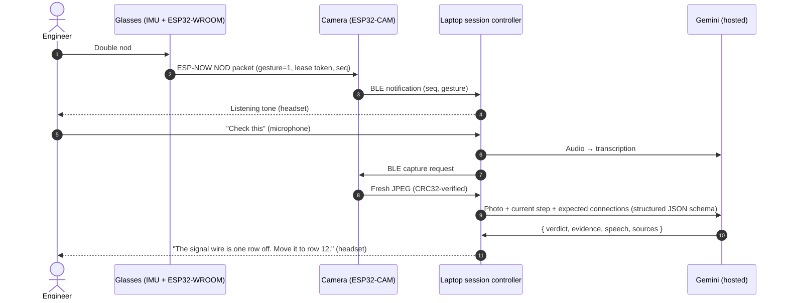
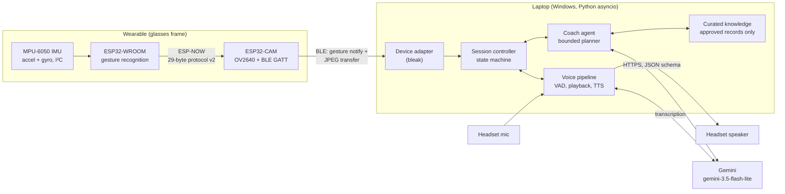
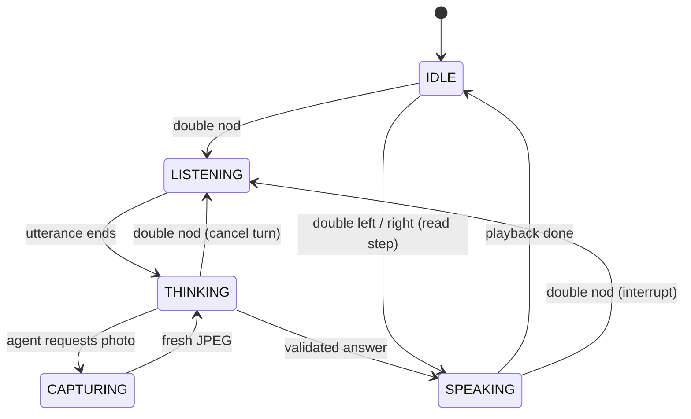

# Verity

**A hands-free AI debugger for physical hardware.**

Software has debuggers. Your workbench should too.


Verity is a pair of camera-equipped smart glasses and a laptop companion that let
an engineer debug a circuit **without putting down their tools or looking at a
screen**. Double nod, say *"check this"*, and Verity photographs the build from
your point of view, compares it against the expected connections, and tells you
through a headset whether it passes, what looks wrong, or that it cannot tell.


*Verity hardware prototype assembled during the hackathon: ESP32-CAM camera module,
ESP32-WROOM motion sensor node and MPU-6050 IMU mounted on a glasses frame.*

---

## Table of Contents

1. [The Problem](#1-the-problem)
2. [Our Solution](#2-our-solution)
3. [How It Works: One Interaction, End to End](#3-how-it-works-one-interaction-end-to-end)
4. [Technical Build](#4-technical-build)
   - [4.1 System Architecture](#41-system-architecture)
   - [4.2 Wearable Hardware](#42-wearable-hardware)
   - [4.3 Firmware: Head-Gesture Recognition](#43-firmware-head-gesture-recognition)
   - [4.4 Firmware: ESP-NOW Sensor Link](#44-firmware-esp-now-sensor-link)
   - [4.5 Firmware: BLE Camera Service](#45-firmware-ble-camera-service)
   - [4.6 Session Controller](#46-session-controller)
   - [4.7 Voice Pipeline](#47-voice-pipeline)
   - [4.8 AI Inspection Agent](#48-ai-inspection-agent)
   - [4.9 Reliability and Safety by Design](#49-reliability-and-safety-by-design)
5. [Engineering Challenges We Solved](#5-engineering-challenges-we-solved)
6. [Validation and Results](#6-validation-and-results)
7. [Getting Started](#7-getting-started)
8. [Using Verity](#8-using-verity)
9. [Repository Structure](#9-repository-structure)
10. [Limitations and Roadmap](#10-limitations-and-roadmap)
11. [Further Documentation](#11-further-documentation)

---

## 1. The Problem

When software breaks, developers get error messages, stack traces and
step-through debuggers. **When a circuit doesn't work, there is no equivalent.**
The engineer has to trace physical connections by eye, cross-reference a
schematic or tutorial on a separate screen, and reason about what went wrong,
usually while both hands are holding a probe, a soldering iron or a component.

This creates three compounding problems:

| Problem | Why it matters |
|---|---|
| **Context switching** | Every glance from the board to a laptop or phone breaks concentration and forces the engineer to re-find their place on the board. Hands must be freed to scroll, type or search. |
| **Silent, visual faults** | The most common hardware faults (a connector one pin off, an unseated jumper, a reversed component, a wire in the wrong breadboard row) produce no error message. They are only visible, and only if you know what to look for. |
| **Expertise bottleneck** | Students, hobbyists and junior technicians often lack someone experienced looking over their shoulder. Existing AI assistants require typing a description of a physical problem, which is slow and loses the visual detail that actually explains the fault. |

General-purpose chatbots cannot see the bench, and phone camera apps require
free hands and a screen. **Nothing gives a hands-busy builder an expert second
pair of eyes at the moment they need it.**

## 2. Our Solution

Verity puts an AI debugging assistant **into the engineer's field of view**,
controlled entirely by **head gestures and voice**.

| Capability | What the user does | What Verity does |
|---|---|---|
| **Visual debugging** | Double nod, say *"check this"* | Captures a fresh first-person photo, compares it to the expected connections for the current step, and speaks a **pass / issue / unclear** verdict with the visible evidence. |
| **Follow-up questions** | Double nod, ask *"why isn't the LED on?"* | Answers in context of the current step, the conversation history and, when needed, a new photo or curated component documentation. |
| **Guided builds** | Double right / double left head turn | Moves to the next / previous step of a build recipe and reads it aloud, without opening the microphone. |
| **Interruption and control** | Double nod mid-answer, or say *"stop"*, *"repeat"*, *"end session"* | Cancels playback or an in-flight request immediately and returns control to the user. |

Three design principles make Verity trustworthy rather than merely impressive:

1. **Grounded, not guessed.** Every check is judged against an explicit recipe of
   expected connections, and documentation answers can only cite approved,
   curated component records. The agent is instructed and schema-constrained to
   answer **"unclear"** rather than guess when a photo is ambiguous, and it never
   claims electrical continuity or ratings from a picture.
2. **Fresh evidence only.** Every visual verdict is based on a photo captured *for
   that question*. Disconnects raise explicit errors; a cached image is never
   silently reused.
3. **Bounded and interruptible.** Every turn has hard limits on photos, document
   lookups, model calls and wall-clock time, and every stage can be cancelled by
   the user's next gesture.

## 3. How It Works: One Interaction, End to End



The laptop owns Bluetooth, audio, session state and API credentials. Hosted
Gemini provides transcription and multimodal reasoning. No cloud server, rented
GPU or phone app is required.

## 4. Technical Build

### 4.1 System Architecture



The system is split into four components with typed contracts
([docs/CONTRACTS.md](docs/CONTRACTS.md)), developed in parallel by four engineers
and integrated on `main`:

| Component | Responsibility | Key files |
|---|---|---|
| **Device** | Camera, IMU, ESP-NOW and BLE transports; Windows BLE adapter | `firmware/`, `verity/device.py`, `receiver.py` |
| **Voice** | Microphone capture, voice activity detection, transcription, interruptible speech | `verity/voice.py`, `verity/audio/` |
| **Agents** | Multimodal inspection, question answering, grounded documentation lookup | `verity/agents/` |
| **Integration** | Session state machine, CLI, mocks, run logging, demo tooling | `verity/session.py`, `verity/app.py`, `verity/mocks.py` |

### 4.2 Wearable Hardware

| Part | Role | Notes |
|---|---|---|
| **AI Thinker ESP32-CAM** (OV2640) | First-person camera, BLE peripheral, ESP-NOW receiver | VGA JPEG when PSRAM is present (QVGA otherwise), quality 16 |
| **ESP32-WROOM** dev board | Dedicated motion-sensing node | Runs gesture recognition locally; links to the camera over ESP-NOW |
| **MPU-6050** 6-axis IMU | Head-motion sensing | I²C at 100 kHz on SDA 21 / SCL 22; ±2 g, ±250 °/s, 44 Hz DLPF |
| **Glasses frame** | Mounting platform | Camera faces the wearer's line of sight |
| **Wired / USB headset** | Microphone and speaker | Connected to the laptop |

Splitting sensing and imaging across two microcontrollers keeps the IMU sampling
loop independent of camera capture and BLE traffic, and lets each board be
flashed, tested and replaced on its own.

### 4.3 Firmware: Head-Gesture Recognition

Gestures are recognized **on the glasses**, so only discrete, already-validated
events cross the radio link; no raw IMU stream is transmitted.

**Signal pipeline** (`firmware/libraries/VerityLink/src/VerityMotion.h`), at 50 Hz:

1. **Read** accelerometer and gyroscope over I²C (14-byte burst read).
2. **Calibrate** on startup: average 100 still samples (~2 s) to learn the
   wearer's neutral head pitch and the gyroscope's yaw bias.
3. **Pitch** from the gravity vector on a configurable axis, smoothed by a
   first-order low-pass filter.
4. **Yaw** by projecting the gyroscope onto the gravity direction (rotation
   *about* gravity), which is correct regardless of how the board is mounted,
   then integrating with bias correction.
5. **Motion-robust sampling**: samples whose acceleration magnitude falls outside
   0.75–1.25 g (head motion adds linear acceleration) are excluded from pitch,
   while yaw continues integrating against the last good gravity direction.
   Calibration is only discarded after a sustained 1 s sensor outage.

**Gesture detection** (`Verity/NodDetector.h`, `Verity/GestureDetector.h`) is
plain, dependency-free C++ with host unit tests:

- An **excursion detector** recognizes an out-and-back movement with hysteresis
  (for a nod: past 15° down, then back within 6°), a minimum duration to reject
  jitter, a maximum duration so that *looking at the bench* is not a nod, and a
  slowly tracking neutral pose that follows the wearer's posture.
- Three detectors run in parallel: **nod** (pitch), **left turn** and **right
  turn** (yaw, 25° threshold).
- A **double-gesture layer** requires the same gesture twice within 1.5 s and
  pairs each gesture kind independently, so the incidental tilt of a head turn
  cannot cancel a turn pair. A 1.2 s lockout swallows accidental third repeats.

Requiring a *double* gesture makes ordinary head movement while working
extremely unlikely to trigger a command, while staying fast for deliberate use.

### 4.4 Firmware: ESP-NOW Sensor Link

The motion node and camera communicate over **ESP-NOW**: connectionless,
router-free, low-latency Wi-Fi frames between two fixed peers. We designed a
compact **29-byte, versioned binary protocol** with explicit little-endian
encoding (no raw C++ structs on the wire). The full specification is in
[docs/ESP_NOW_PROTOCOL.md](docs/ESP_NOW_PROTOCOL.md).

- **Lease handshake**: `HELLO → CHALLENGE → READY → READY_ACK` establishes a
  per-boot session with random boot IDs, a sender nonce and a camera lease token.
  Delayed or replayed packets from an old session are fenced out.
- **Exactly-once gesture delivery**: each gesture carries a stable event ID with
  up to four retries 150 ms apart. The camera consumes each event once and
  acknowledges it as `Forwarded`, `Dropped`, `Duplicate` or `Expired`, so a lost
  ACK can never trigger a second action.
- **Freshness bounds**: a gesture older than 700 ms (sender age plus camera queue
  residence) is discarded rather than delivered late, so a stale command is
  never acted on.
- **Liveness**: `STATUS` heartbeats every 300 ms carry sensor / calibrated /
  settled flags; either side expires the link after 1.2 s of silence.
- **Interrupt-safe**: radio callbacks only timestamp and enqueue (bounded queue,
  no allocation, no blocking); all logic runs in the main loop.

### 4.5 Firmware: BLE Camera Service

The ESP32-CAM exposes a custom **NimBLE GATT service** (advertised as
`CircuitGlasses`) to the laptop (`firmware/CircuitGlasses/BleCamera.h`):

- **On-demand capture**: the laptop requests a photo; the camera discards any
  buffered frame and captures a fresh one, optionally waiting (bounded) for head
  motion to settle so the image is not blurred.
- **Integrity-checked transfer**: frame length and a **CRC32** are published
  first; the laptop reads the JPEG in MTU-sized chunks (MTU negotiated up to 247)
  and rejects any image whose checksum does not match.
- **Gesture notifications**: each validated head gesture is forwarded to the
  laptop as a 5-byte notification (`seq:u32`, `gesture:u8`).

### 4.6 Session Controller

The controller (`verity/session.py`) is an **asyncio state machine** that owns all
session state. Components never mutate state directly; the agent can only
*suggest* a step change.



- **One turn at a time**: each turn has an ID; results from a cancelled turn are
  dropped, never spoken.
- **Local fast paths**: *repeat*, *stop*, *next*, *back* and *end session* are
  handled without a model call.
- **Honest progression**: a manual *next* never claims the previous step was
  verified, and a *pass* does not auto-advance; Verity invites the user to move on.
- **Session logging**: every turn (question, verdict, evidence, photo) is written
  to `runs/<timestamp>/` for review, and Q&A is echoed to the console for onlookers.

### 4.7 Voice Pipeline

- **Capture and endpointing**: native-rate microphone capture with stereo
  downmix, and energy-based voice activity detection that **auto-calibrates to
  the room** from one second of ambient noise at startup (3× noise RMS, clamped).
  Recording ends after 0.8 s of silence or a 10 s cap; silence skips the API call.
- **Transcription**: hosted Gemini speech-to-text.
- **Speech output**: local system text-to-speech (no API cost or network latency)
  with **cancellable playback**, so a double nod cuts an answer off immediately.
  Audio cues (listening / working / error) give eyes-free feedback.

### 4.8 AI Inspection Agent

The Coach (`verity/agents/coach.py`) is a **bounded planner**, not an open-ended
agent loop:

| Request | Route | Model calls |
|---|---|---|
| *"Check this"* | Deterministic inspection: one fresh capture, one structured model call | 1 |
| Natural question | Structured planning call → at most one capture and two scoped document lookups → structured answer call | ≤ 2 |
| *Repeat / stop / next* | Handled locally | 0 |

Every response is validated against a strict JSON schema before it is spoken:

```json
{
  "speech": "The signal connector appears unplugged. Connect it to the pin marked S.",
  "intent": "check",
  "verdict": "issue",
  "evidence": ["Signal connector is visibly disconnected."],
  "suggested_step_index": null,
  "sources": [],
  "needs_clarification": false
}
```

- **Verdicts** are `pass`, `issue`, `unclear` or `not_checked`, and code-level
  validation (not just prompting) enforces their meaning:
  - a visual verdict **without a fresh photo is rejected**, so a guess cannot be
    passed off as an inspection;
  - `pass` and `issue` **must cite visible evidence**, and a `pass` cannot
    coexist with a request for clarification;
  - the model **cannot advance steps or change control state**; only the
    controller can.
- **Grounded citations**: documentation lookups search only curated records that
  are explicitly `approved` and scoped to the current recipe
  ([knowledge/README.md](knowledge/README.md)). The model may only reference
  sources that were actually retrieved in that turn, by ID; the cited title,
  locator and excerpt are filled in **verbatim from the store**, so the model
  never writes citation text itself.
- **Hard limits**: a 45 s turn deadline that covers capture, lookup and model time;
  per-call deadlines (30 s total, 10 s connect); no retries and no recursive loops.
- **Privacy-aware logging**: agent logs record turn IDs, stage timing and verdicts,
  never API keys, image bytes, transcripts or document text.

### 4.9 Reliability and Safety by Design

| Risk | Mitigation |
|---|---|
| Accidental activation while working | Double gestures only, 1.2 s lockout, cooldown, gestures validated on-device |
| Acting on a stale command | 700 ms gesture freshness bound; reconnects never replay old gestures |
| Duplicate actions from radio retries | Event IDs and ACK dispositions give exactly-once consumption |
| Verdict from an old or corrupted image | Fresh capture per question; CRC32 verification; disconnect is an explicit error |
| AI overconfidence | `unclear` verdict; visual verdicts without a fresh photo or without evidence are rejected in code; no continuity or rating claims from images |
| Hallucinated references | Approved, recipe-scoped knowledge only; the model cites retrieved IDs and the quoted text is inserted verbatim from the store |
| Runaway cost or latency | ≤ 1 capture, ≤ 2 lookups, ≤ 2 model calls, 45 s deadline per turn; no retries |
| Leaked credentials | API key entered at a hidden prompt and stored only in a git-ignored local file |

## 5. Engineering Challenges We Solved

**Gesture readings vanished the moment the user moved.** In the first hardware
test the IMU worked perfectly while still, but no gesture ever registered. The
serial logs showed telemetry stopping at the start of every movement, followed by
recalibration. Root cause: the motion filter treated *any* sample outside
0.75–1.25 g as a sensor fault and reset everything, but real nods and turns
produced **0.18–2.62 g**. Each gesture wiped its own calibration. We changed
invalid samples to be skipped instead of resetting, kept yaw integrating through
them, and added on-device diagnostic counters. The maximum telemetry gap fell to
**0.2 s**, with a single calibration per session.

**The nod axis was wrong for the real mounting.** Rather than guessing, we added
raw accelerometer output and ran a slow, single-movement orientation test. It
showed that looking down moves gravity from the −Y to the −Z axis, while the
firmware was reading pitch from X. Correcting one configuration value turned a
60° look-down from a ~20° reading into a full-scale signal.

**Thresholds tuned on real people, not guesses.** The original timing parameters
(900 ms) were untested defaults. Bench recordings showed deliberate double
gestures finish about 1.2 s apart, and that turning the head also tilts it,
injecting stray "nods" between turn pairs. We built a Python replay tool that
runs recorded sensor logs through an exact port of the firmware detectors, used it
to choose new limits (1.5 s double window, per-gesture-kind pairing), and
confirmed zero false positives on slow-movement recordings before flashing.

**Result:** command recognition went from **0 of 9** doubles to **14 of 14**
correct doubles during steady-state use on the hardware
([full report](docs/HARDWARE_TEST_2026-10-24.md)).

**Hosted model latency.** The default model alias exceeded our 20–30 s targets
for image requests. Systematic diagnostics led us to pin
`gemini-3.5-flash-lite`, which completed image + structured-JSON requests in
under a second, and to add total asyncio deadlines with clean cancellation
([report](docs/AGENTS_VALIDATION.md)).

## 6. Validation and Results

All measurements below were observed on October 24, 2026. They are individual
observations from bench sessions, not a formal benchmark.

| Area | Result |
|---|---|
| **Gesture recognition on hardware** | 14 / 14 double gestures (nod, left, right) recognized correctly in steady-state use, after fixing the issues above (previously 0 / 9) |
| **IMU link robustness** | 0 I²C failures across all sessions; max telemetry gap 0.2 s during vigorous motion |
| **False positives** | 0 commands from slow, single head movements (hardware recordings, replayed through the final detector settings) |
| **Hosted text request** | 0.7 s |
| **Image + structured JSON** | 0.9 s, correct result |
| **Coach: general question** | 1.8 s, correctly marked `not_checked` (no photo taken) |
| **Coach: ambiguous (blank) image** | 4.6 s, correctly returned `unclear` and asked for a clearer view |
| **Full pipeline** (speech → transcription → coach with image → speech synthesis) | 6.1 s |
| **Camera → laptop over BLE** | 13,180-byte JPEG received and verified (20.1 s; see roadmap) |
| **Firmware builds** | ESP32-CAM and ESP32-WROOM sketches compile with Arduino-ESP32 3.3 and NimBLE-Arduino 2.3.6 |

**Automated tests:** 97 Python tests covering the BLE protocol and adapter,
ESP-NOW framing, recording endpoint logic, voice cancellation, agent schemas and
tool limits, HTTP failure handling and the session state machine (interruption,
cancellation and recovery). Two firmware C++ suites (`firmware/tests/`) exercise the
gesture detectors and the full ESP-NOW protocol lifecycle: encoding, retries, ACK
loss, duplicates, reordering, expiry, reboots and `millis()` rollover. They run on
any host `g++` (on Windows, via WSL).

```powershell
.\.venv\Scripts\python.exe -m unittest discover -s tests -v
```

## 7. Getting Started

### Prerequisites

- Windows 10/11 with Bluetooth LE, Python 3.11+
- A Gemini API key ([Google AI Studio](https://aistudio.google.com/apikey))
- For hardware: AI Thinker ESP32-CAM, ESP32-WROOM, MPU-6050, Arduino IDE 2 with
  Arduino-ESP32 3.3.x and NimBLE-Arduino 2.3.6

### Quick start (no hardware required)

```powershell
git clone https://github.com/Da0t/Verity.git
cd Verity
py -3 -m venv .venv
.\.venv\Scripts\python.exe -m pip install -r requirements.txt
.\.venv\Scripts\python.exe -m verity.agents.setup --model gemini-3.5-flash-lite --save
.\.venv\Scripts\python.exe -m unittest discover -s tests -v
.\.venv\Scripts\python.exe -m verity.app --mock
```

The setup tool asks for the Gemini key at a hidden prompt, verifies it with a real
image + structured-output request, and saves it to the git-ignored `.env.agents`.
**Mock mode** runs a scripted six-turn session (instruction, check, question,
repeat, next, stop) with simulated gestures, audio, camera and model, all clearly
labeled as simulated. It needs no hardware, microphone or API key.

### Try the real AI without the glasses

```powershell
# Real microphone, transcription, coach and speech; keyboard replaces gestures
# (Enter = double nod, n / b = next / back, q = quit); "check this" uses bench.jpg
.\.venv\Scripts\python.exe -m verity.app --keyboard --allow-template --photo bench.jpg

# Microphone → AI → spoken reply, with a fixed reference photo
$env:VERITY_STT_MODEL = 'gemini-3.5-flash-lite'
.\.venv\Scripts\python.exe -m verity.app --voice-only --input-device INPUT_ID --output-device OUTPUT_ID
```

Photo-based modes test the pipeline, not live inspection: the image is a file, not
a fresh camera view.

### Hardware setup

1. **Flash the camera**: open `firmware/CircuitGlasses/CircuitGlasses.ino`, select
   *AI Thinker ESP32-CAM*, and install the repo's `firmware/libraries/VerityLink`
   library. See [device setup](docs/DEVICE_SETUP.md) and
   [firmware build](docs/FIRMWARE_BUILD.md).
2. **Flash the motion sensor**: open `firmware/ImuSender/ImuSender.ino` for
   *ESP32 Dev Module*. Set I²C pins, pitch axis and both boards' MAC addresses in
   each `Config.h` as described in the [two-board setup](docs/ESP_NOW_SETUP.md).
3. **Calibrate**: power both boards and hold the glasses still for about two
   seconds. With `VERITY_IMU_DEBUG 1`, the serial monitor (115200 baud) streams
   pitch, yaw, status flags and diagnostic counters.
4. **Audio**: connect the headset and select it:

   ```powershell
   .\.venv\Scripts\python.exe -m verity.app --list-audio-devices
   .\.venv\Scripts\python.exe -m verity.app --audio-check --input-device ID --output-device ID
   ```

   Stay quiet for the first second while the voice detector calibrates
   (`--vad-threshold 0.015` fixes the threshold instead).

### Define the circuit to debug

A **recipe** is the ground truth Verity checks against: each step lists an
instruction and the expected visible connections. For pure debugging a single
step describing the finished circuit is enough; for guided builds, list every step.
Copy the generic template `recipes/demo.json`, replace its steps with your verified
build, set `template` to `false`, and optionally add `reference_image` paths and
approved component documentation ([knowledge/README.md](knowledge/README.md)).

```powershell
.\.venv\Scripts\python.exe -m verity.app --recipe recipes/your-circuit.json
```

The app refuses the generic template in live mode unless `--allow-template` is
passed, so a placeholder can never be mistaken for a verified circuit.

## 8. Using Verity

| Input | Action |
|---|---|
| **Double nod** | Listening tone, then ask one question |
| *"Check this"* | Fresh photo → pass / issue / unclear with visible evidence |
| *"Why isn't the LED on?"* (any question) | Contextual answer; may take a photo or cite documentation |
| **Double right turn** / **double left turn** | Next / previous step, read aloud (no listening) |
| *"What is the next step?"* | Reads the current instruction |
| *"Next"* / *"Back"* | Manual step change (never marked as verified) |
| *"Repeat"* | Replays the last answer with no model call |
| **Double nod while Verity is speaking or thinking** | Interrupts and listens again |
| *"Stop"* (after activating) | Cancels the request |
| *"End session"* | Exits |

A single nod or turn does nothing, by design.

## 9. Repository Structure

```text
Verity/
├── firmware/
│   ├── CircuitGlasses/         # ESP32-CAM: camera, BLE GATT service, ESP-NOW receiver
│   ├── ImuSender/              # ESP32-WROOM: MPU-6050 sampling, gestures, ESP-NOW sender
│   ├── libraries/VerityLink/   # Shared C++: motion filter, gesture detectors, link protocol
│   └── tests/                  # Host-compiled C++ unit tests
├── verity/
│   ├── app.py                  # CLI entry point and mode selection
│   ├── session.py              # Turn state machine, interruption, run logging
│   ├── device.py               # Windows BLE adapter (gestures + JPEG capture)
│   ├── voice.py, audio/        # VAD, transcription, TTS, cancellable playback
│   ├── agents/                 # Coach planner, Gemini provider, prompts, schemas, knowledge
│   ├── mocks.py                # Simulated and keyboard devices for testing
│   └── diagnostics.py          # Live end-to-end hosted pipeline check
├── recipes/                    # Circuit definitions (ground truth for checks)
├── knowledge/                  # Curated, approved component documentation
├── tests/                      # Python test suite
├── receiver.py                 # Stand-alone camera transfer diagnostic
└── docs/                       # Contracts, protocol spec, setup guides, test reports
```

## 10. Limitations and Roadmap

We distinguish clearly between what is verified and what is next.

**Current limitations**

- **Photo transfer speed.** Chunked BLE reads currently take ~20 s for a 13 KB
  JPEG. Switching the transfer to BLE notifications with a larger negotiated MTU
  is the next optimization.
- **Integration on the glasses.** Gesture recognition and photo transfer have each
  been validated on hardware; the combined camera + motion-node run on the
  assembled glasses is in progress. Gesture thresholds were tuned with the board
  hand-held and will be re-checked once mounted.
- **Visual inspection only.** A photo cannot establish continuity, voltage or
  electrical safety, and Verity says so. Accuracy on specific circuits has not yet
  been benchmarked.
- **Bench-grade radio security.** The ESP-NOW link uses MAC filtering and session
  tokens to prevent cross-talk and replay, not cryptographic authentication.

**Roadmap**

- Faster BLE image transfer (notifications, larger MTU, adaptive resolution)
- Visual "calibrated / ready" cue on the glasses
- Measurement integration: read a Bluetooth multimeter so Verity can combine what
  it sees with what is measured
- Automatic recipe generation from a schematic or tutorial
- A benchmark set of common wiring faults to measure inspection accuracy

## 11. Further Documentation

| Document | Contents |
|---|---|
| [CONTRACTS.md](docs/CONTRACTS.md) | Typed interfaces between device, voice, agent and controller |
| [ESP_NOW_PROTOCOL.md](docs/ESP_NOW_PROTOCOL.md) | Wire format, handshake, delivery and freshness rules |
| [ESP_NOW_SETUP.md](docs/ESP_NOW_SETUP.md) | Two-board wiring, MAC and channel configuration |
| [DEVICE_SETUP.md](docs/DEVICE_SETUP.md) / [FIRMWARE_BUILD.md](docs/FIRMWARE_BUILD.md) | Camera board setup and firmware builds |
| [VOICE_SETUP.md](docs/VOICE_SETUP.md) | Audio devices, VAD and speech configuration |
| [AGENTS_SETUP.md](docs/AGENTS_SETUP.md) / [AGENTS_VALIDATION.md](docs/AGENTS_VALIDATION.md) | Coach design, model selection and live API results |
| [HARDWARE_TEST_2026-10-24.md](docs/HARDWARE_TEST_2026-10-24.md) | Hardware bring-up, IMU diagnosis and gesture validation |
| [DEMO.md](docs/DEMO.md) | Integrated demo procedure and operator commands |
| [TEAM_PLAN.md](docs/TEAM_PLAN.md) | Four-person ownership and integration plan |
